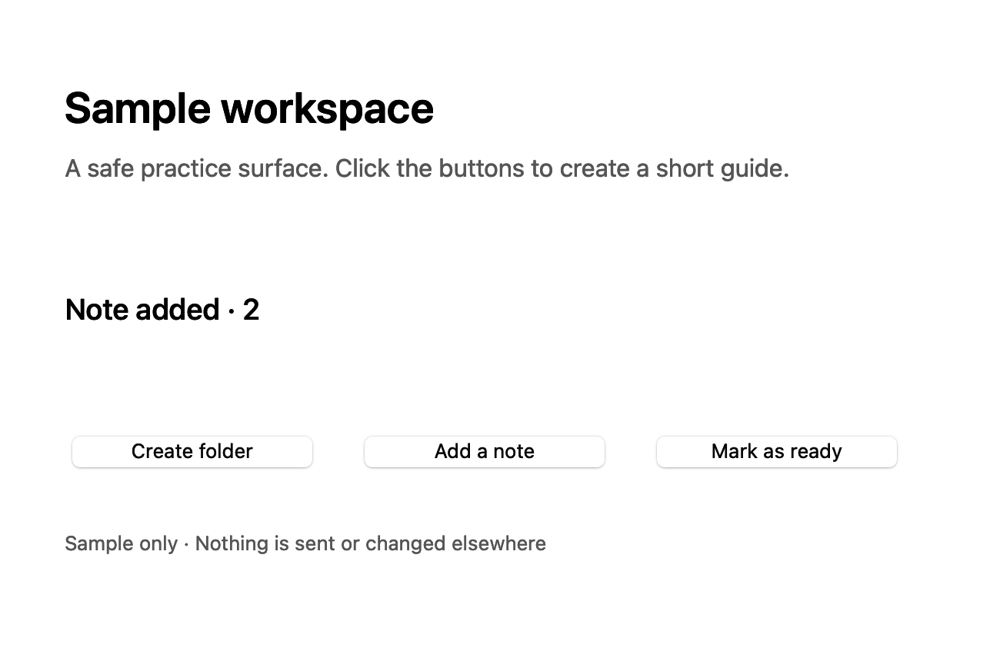

# Guides Replica

An independent, local-first recreation of selected step-by-step guide authoring workflows. It uses an original native macOS implementation and a separate Neutral Core identity. The available reference evidence and fidelity gaps are listed in [public verification](PUBLIC-VERIFICATION.md); exact commercial UI parity is not claimed.

**Experimental Neutral Core Replica.** Only `baseline` is enabled in this repository's distribution configuration.

## Build and open

Requires macOS 14 or later and Apple's Command Line Tools with Swift 6. Build the default Neutral Core Replica:

```sh
swift test
./scripts/build-app.sh
open 'dist/Guides Replica.app'
```

The `baseline` edition is the only distribution in this repository. Its original neutral hierarchy is based on the documented reference evidence; the live signed-in editor and external capture acceptance remain unverified. See [public verification](PUBLIC-VERIFICATION.md) for the bounded evidence and gaps.

Packages are ad-hoc signed locally, **not notarised**. Build from source on your Mac or inspect the specific macOS security review for a downloaded binary. Do not disable Gatekeeper globally. [AI setup prompt and checks](docs/AI-SETUP.md).


## Optional stable local signing

Builds default to local ad-hoc signing and are not notarised. If this Mac already has a valid Apple Development signing identity, the build can select it with `PIP_GUIDES_SIGNING_IDENTITY` set to its 40-character fingerprint, or with an ignored `.local-signing-identity` file in this app directory containing that fingerprint. The environment variable takes precedence. The identity must already be installed and valid; the selector does not create or download certificates or keys. Invalid, unavailable or wrong-type selections fail closed before compilation and do not fall back to ad-hoc signing.

No signing identity, certificate or private key is included in this repository. The local selector file is ignored and excluded from the source-input manifest. Using the same installed identity can retain a stable code-signing requirement across builds, but macOS Screen Recording and Accessibility permission inheritance is not guaranteed. Check the exact running build's permission result; see [public verification](PUBLIC-VERIFICATION.md).

A prior frozen Pip Core build (`e622`, app-input SHA-256 `0a75c8c63dcbf62208b95065fc9744136a5f3c3ad3d80b59745943f4c0bddf6f`) returned false for Screen Recording preflight while System Settings showed Screen Recording and Accessibility enabled. A separate bounded Sample/editor walkthrough on that exact build saved a picture, persisted edits across quit/reopen, and verified Open-panel cancellation; it did not test external capture. This evidence is for Pip Core only and does not establish permission inheritance for this Replica product or any new candidate. See [the bounded verification record](PUBLIC-VERIFICATION.md).

## Make your first guide

1. Choose **New guide**, then write the guide title and summary.
2. Choose **Insert step** and write a title and description. You can add a PNG or JPEG picture.
3. To capture a process, choose **Record clicks**. Try **Use the Sample practice window** first, or allow access and refresh the external window list. Choose one window and start.
4. Click through the process. Pause before anything private. Stop when finished.
5. Edit descriptions, move or delete steps, crop pictures, apply solid redactions and outline areas. Image changes are permanent and clear step undo history. The area fields support editing without dragging.
6. Review every picture, then export HTML, Markdown, PDF or an editable guide file.

The practice window is a genuine local native test surface with synthetic content; it does not validate external-window capture or its permissions. No typed keys are monitored. Automatic descriptions are basic action labels that you edit yourself.

## Verified sample capture



This is a saved picture from the built-in Sample practice window, captured after a coordinate click. It documents the synthetic practice surface; it is not the app's editor UI and does not establish external-window capture acceptance.

## Exports and local storage

- **HTML:** one file with embedded PNGs, no scripts or external resources. Open in a browser.
- **Markdown:** one file with embedded data images. Some Markdown viewers block data URLs; use HTML for portable viewing.
- **PDF:** paginated text and pictures for reading or printing.
- **Guide file:** editable `.pipguide` JSON with embedded images. Open in either edition. Import creates a new library copy.

Guides Replica stores guides under `~/Library/Application Support/Guides Replica/`. A last-good `.backup` copy supports recovery from a corrupt current file. Quit attempts a final save and stays open if saving fails unless the current edits were successfully exported as a portable guide file. Guide files are private to your user account via filesystem permissions, **not encrypted**. Protect your Mac and choose where exports go. Existing exports, Time Machine snapshots and other backups are independent copies; redaction cannot erase those.

Solid redaction replaces pixels. Crop removes pixels outside the area. Blur is cosmetic and can leave information readable. Image edits discard the previous picture in the current document, step undo history and app recovery copy after a successful save. A failed save leaves a visible warning. Review all exports before sharing. Pictures may contain private information that macOS does not expose as a secure control.

## Permissions and limits

External recording uses Apple's ScreenCaptureKit and click-only event observation. It needs **Screen & System Audio Recording** and **Accessibility** for secure-control checks. Enable only this app in System Settings when you decide to use it. Restart if macOS requests it, then refresh windows. Manual editing, import/export and the practice surface work without those grants.

Capture is limited to the selected window and accepted clicks in the foreground app. Secure controls recognised through Accessibility are skipped or covered before saving. Custom controls can evade detection: pause before passwords, payment details and sensitive work. Read failures pause or skip capture instead of collecting the whole desktop. No keyboard values, microphone or system audio are collected. No network client or telemetry is included. Links in About open only on request.

Current bounds: 200 steps, 16 MB per PNG and 150 MB combined PNG data. Very large guides may be slow. Multiple-display capture, secure-field detection across third-party apps, VoiceOver and packaging on other Macs require explicit runtime evidence; see [public verification](PUBLIC-VERIFICATION.md). No Windows/Linux build is claimed. OCR, browser extensions, team sharing and automatic written descriptions are not implemented.

## Keyboard and help

Command-N new guide, Command-O open guide file, Command-S save, Shift-Command-I insert step, Shift-Command-R record, Command-period stop, Command-E export, Option-Command-Z undo a structural step change. Native text editors keep normal text editing. Image changes clear structural undo deliberately. Use About and help for local storage and permission guidance.

If saving fails, keep the app open and export a guide file to another location. After a successful portable export you can switch guides or quit without losing those exported edits. A recovered guide is explicitly labelled. The app keeps unreadable files rather than deleting them. To back up everything, copy the data directory while the app is closed. To remove local data, close the app and move the selected guide and recovery files to Trash yourself.

## Project

Maintained by [Ghostzy0](https://github.com/Ghostzy0). MIT licensed original implementation. Documented workflow references: [Wegweiser](https://github.com/Sauerbac/Wegweiser), [Scribe](https://scribehow.com) and [Tango](https://www.tango.ai). No affiliation or claim of complete parity. No proprietary reference assets, restricted Pip character engine or upstream code are bundled. [Provenance](UPSTREAM.md), [notices](NOTICES.md), [design](DESIGN.md), [changelog](CHANGELOG.md), [contributing](CONTRIBUTING.md), [security](SECURITY.md).

[Frequently asked questions](docs/FAQ.md) · [Move existing material](docs/MIGRATION.md)
